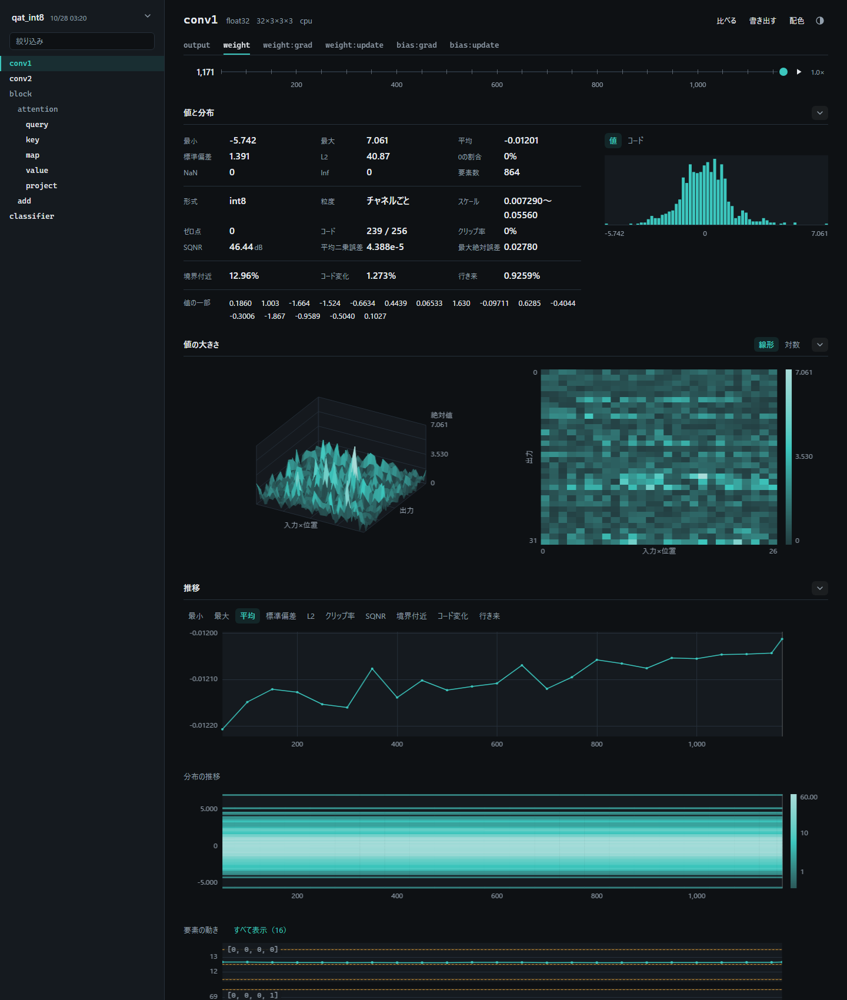
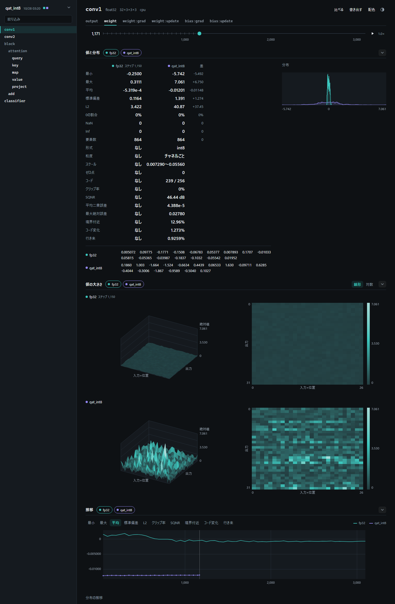

# tensight 使い方ガイド

tensight は、PyTorch の学習の途中で、モデルの中のテンソル（層の出力、重み、勾配など）を記録し、ブラウザで見るための道具です。記録するのは、最小・最大・平均などの数、値の分布、量子化しているときのスケールやコードの使われ方です。

初めて使うときは、1章の手順で記録して画面を開き、2章で画面の見方を確かめてください。2つの学習を比べるときは3章、記録する中身を変えるときは4章を読みます。

## 1. 記録して画面を開くまで

### 1.1 入れる

tensight は PyPI にありません。tensight のフォルダ（README.md があるフォルダ）を手元に置き、使うプロジェクトのフォルダで次を実行します。

```bash
uv add ../torch-data-viewer
```

`../torch-data-viewer` は、tensight のフォルダの場所に合わせて変えます。PyTorch もいっしょに入ります。Python 3.14 以上と PyTorch 2.14 以上で動きます。

### 1.2 学習のスクリプトに5行を足す

番号のコメントの行が、足す5行です。

```python
import tensight as ts                              # 1

ts.run_start(log_dir="runs", name="int8_qat")      # 2: 記録を始める
ts.watch_model(model, optimizer)                   # 3: 記録するモデルを登録する
for x, y in loader:
    loss = criterion(model(x), y)
    optimizer.zero_grad()
    loss.backward()
    optimizer.step()
    ts.run_step()                                  # 4: 1ステップ終わったことを知らせる
ts.run_close()                                     # 5: 記録を閉じる
```

- `ts.run_step()` は、`optimizer.step()` のあと、ループの最後に置きます。tensight は、`run_step()` を呼んだ回数でステップを数えます。
- 既定では、100 ステップに1回だけ記録します。記録しないステップでは、ほとんど時間がかかりません。
- 既定で記録するのは、すべての層の出力です。重みや勾配も見るときは、4.1 のように `kinds` を指定します。
- `name` は実行（1回の学習）の名前です。英数字と `-`、`_` が使えます。同じ記録フォルダに、名前を変えて何回でも記録できます。

### 1.3 画面を開く

記録フォルダ（上の例では runs）の中の index.html を、ダブルクリックしてブラウザで開きます。サーバーもインターネットも要りません。Chrome、Edge、Firefox で開けます。

学習の途中で開いてもかまいません。新しく記録したステップを見るときは、ページを再読み込み（F5）します。選んでいた実行・観測点・ステップは、再読み込みしても変わりません。

## 2. 画面の見方



### 2.1 左側: 実行と観測点

- いちばん上が、見ている実行の名前です（図では qat_int8）。押すと、実行の一覧が開きます。
- 一覧の各行には、四角と名前があります。名前を押すと、その実行だけを表示します。四角を押すと、その実行を表示に足したり、表示から外したりします（3章）。
- 一覧のいちばん下の「ほかの記録フォルダを読み込む」を押すと、別のフォルダの記録もいっしょに見られます。
- その下の木が、観測点（記録した層やパラメータ）の一覧です。層の入れ子の順に並びます。「絞り込み」に名前の一部を入れると、その文字を含む観測点だけが残ります。
- NaN か Inf が出た観測点には、警告の色の丸が付きます。

### 2.2 上: 観測点の名前、種類、ステップ

観測点の名前の横に、データ型、形、デバイスが出ます。その下のタブで、同じ層の別の種類の記録に切り替えます。

| タブ | 中身 |
|---|---|
| input、output | 層の入力、層の出力 |
| output_grad | 層の出力に対する勾配 |
| weight、bias | パラメータの値 |
| weight:grad、bias:grad | パラメータの勾配 |
| weight:update、bias:update | 1ステップでのパラメータの変化（更新量） |
| note | `note_tensor` で名前を付けて記録したテンソル（4.4） |

タブの下の横長のバーで、ステップを選びます。点をドラッグするか、← → キーで、記録したステップに移ります。▶ で再生し、その右の 1.0× で再生の速さを変えます。

### 2.3 値と分布

- 左の表は、選んだステップの数です。最小、最大、平均、標準偏差、L2（二乗和の平方根）、0 の割合、NaN と Inf の個数、要素の数が出ます。
- 量子化している観測点では、形式、粒度、スケール、ゼロ点、使ったコードの数、クリップ率、誤差などの行が足されます（5章）。
- update のタブでは、更新率（更新量の L2 を、更新前の重みの L2 で割った値）の行が足されます。層ごとの学習の速さの目安になります。
- 右は値の分布です。量子化している観測点では、「コード」を押すと、コードごとの要素の数に切り替わります。
- 「値の一部」は、テンソルの先頭の要素の値です（既定で 16 個）。

### 2.4 値の大きさ（地図）

地図は、テンソルを縦と横の2つの向きにまとめ、各マスに、まとめた要素の絶対値の最大を入れたものです。地図を記録した観測点（4.3）だけに出ます。

- 左の3次元の図は、高さと色で値を表します。ドラッグで回し、ダブルクリックで元の向きに戻します。
- 右の上から見た図は、色で値を表します。右のカラーバーが、色と値の対応です。2つの図は、同じ値を同じ色で塗ります。
- 地図の値は 256 段階で記録します。そのため、最大の約 1/500 より小さい値は 0 として記録され、いちばん下の色と高さになります。

### 2.5 推移

ステップを横軸にした図が、3つ並びます。

- 推移: 上のボタン（最小、最大、平均など）で選んだ数の、ステップごとの変化です。図を押すと、そのステップに移ります。
- 分布の推移: 横がステップ、縦が値で、色がその値の要素の数を表します（右のカラーバー）。分布が広がったり、ずれたりする様子が分かります。
- 要素の動き: パラメータのいくつかの要素の値の変化です。量子化しているときは、表せる値の線と、境界の近くを示す帯も引かれます（5章）。最初は 6 個だけ出し、「すべて表示（個数）」を押すと全部を出します。

### 2.6 右上のボタン

| ボタン | すること |
|---|---|
| 比べる | 量子化の前と後のモデルの出力の誤差を、観測点ごとに一覧にする（3.3） |
| 書き出す | 「HTML に書き出す」で、いま見ている観測点の表示を1つの HTML ファイルにする。重ねている実行と、たたんだまとまりも、そのまま入る。「CSV に書き出す」で、主の実行の統計を CSV にする |
| 配色 | 画面の色（パレット）と、図の色（カラーマップ）を選ぶ |
| ◐ | 明るい画面と暗い画面を切り替える |

## 3. 2つの学習を比べる



### 3.1 2つの実行を表示する

左上の実行の名前を押して一覧を開き、比べたい実行の四角を押します。表示している実行の四角は、色で塗られます。その色が、表と図の中のその実行の色です。

- 表示している実行が1つだけのときは、その四角を押しても外れません。いつも1つ以上の実行を表示します。
- 名前が太字の実行が「主の実行」です。左の観測点の一覧は、主の実行のものです。
- ステップのバーは、表示しているどれかの実行が記録したステップに止まります。
- 同時に表示できる実行は 5 個までです。5 個を表示しているときは、ほかの実行の四角が薄くなり、押せません。1つ外すと押せます。
- 選んだステップの記録がない実行には、それより前のいちばん近いステップの記録が出ます。このときは、名前の横に「ステップ 1,150」のように、使ったステップが出ます。

### 3.2 まとまりごとに出す・消す

2つ以上の実行を表示すると、「値と分布」「値の大きさ」「推移」の見出しに、実行のチップ（色の丸と名前）が並びます。

- チップを押すと、そのまとまりだけで、その実行を消したり出したりします。ほかのまとまりは変わりません。
- 出している実行が1つだけになったまとまりでは、そのチップを押しても消えません。
- 見出しの右端のボタン（⌄）で、まとまりをたたみます。たたんだまとまりは、次に開いたときもたたまれています。

2つの実行を出したときは、次のように並べるか重ねます。

| まとまり | 表示 |
|---|---|
| 値と分布 | 表に実行ごとの列が並ぶ。実行が2つのときは「差」（2列目 − 1列目）の列が足される。分布は、実行の色の線で重なる |
| 値の大きさ | 実行ごとに1行ずつ並ぶ。色と高さの目盛りは、どの実行の図でも同じ。1つの3次元の図を回すと、ほかの3次元の図も同じ向きに回る |
| 推移 | 推移の線が重なる。分布の推移は、実行ごとの帯になる。要素の動きは、同じ要素の帯に、実行ごとの線が重なる |

### 3.3 量子化の前と後の誤差を一覧にする（比べる）

量子化の前のモデルと後のモデルに同じ入力を入れ、観測点ごとの誤差（平均二乗誤差と SQNR）を一覧にできます。両方の実行で、同じステップのテンソル全体を `compare_steps` で保存しておきます。

```python
for name, net in (("float", float_model), ("int8", int8_model)):
    ts.run_start(log_dir="runs", name=name, interval=1, compare_steps=(1,))
    ts.watch_model(net)
    net(fixed_batch)
    ts.run_step()
    ts.run_close()
```

画面右上の「比べる」を押し、基準の実行（量子化の前）、比べる実行（量子化の後）、ステップを選ぶと、観測点ごとの誤差が並びます。列の見出しを押すと並べ替わります。行を押すと、その観測点の表示に戻ります。

## 4. 記録する中身を変える

`ts.run_start` の引数で、何をどれだけ記録するかを決めます。よく使う引数は次のとおりです。すべての引数は、docs/v-model/02a_API仕様書.md の API-01 にあります。

| 引数 | 既定 | 意味 |
|---|---|---|
| log_dir | tensight_runs | 記録フォルダ |
| name | なし（開始の日時だけ） | 実行の名前 |
| interval | 100 | 何ステップに1回記録するか |
| kinds | ("output",) | 記録する種類（input、output、output_grad、weight、bias、grad、update） |
| points | すべての層 | 記録する層の名前のパターン。`*` は何文字にも、`?` は1文字に当てはまる |
| maps | なし | 地図を記録する観測点と、地図の作り方（4.3） |
| track_elements | パラメータの先頭の 16 個 | 「要素の動き」に出す要素 |
| compare_steps | なし | 「比べる」のために、テンソル全体を保存するステップ（3.3） |

### 4.1 重み・勾配・更新量も記録する

```python
ts.run_start(log_dir="runs", name="qat", kinds=("output", "weight", "grad", "update"))
ts.watch_model(model, optimizer)
```

更新量（update）を記録するときは、`watch_model` に optimizer も渡します。

### 4.2 一部の層だけを記録する

```python
ts.run_start(log_dir="runs", points=["layer3.*", "fc"])
```

見たい層が決まっているときや、記録に時間がかかるときに使います。`ts.watch_model` は、登録した観測点の名前の一覧を返すので、print すると何を記録するかを確かめられます。

### 4.3 地図を記録する

```python
ts.run_start(log_dir="runs", maps={"*": "auto"})
```

`maps` には、観測点の名前のパターンと、地図の作り方を書きます。`"auto"` にすると、層の種類から作り方を選びます。作り方を名前（プリセット）で指定することもできます。

| 名前 | 向いているテンソル |
|---|---|
| conv2d | 畳み込み層の入出力。チャネルどうしを比べる |
| conv2d_image | 畳み込み層の入出力。画像の中の位置どうしを比べる |
| tokens | Transformer の層の入出力 |
| attention_qk | attention の重み（query × key） |
| weight | 2次元以上のパラメータ |

ほかのプリセットと、並べ方を自分で書く方法は、02a の4章「地図の作り方」にあります。

### 4.4 層の出力でないテンソルを記録する（attention map など）

forward の途中のテンソルは、`ts.note_tensor` で名前を付けて記録します。渡した値をそのまま返すので、式の中に書けます。

```python
probs = ts.note_tensor("block.attention.map", (q @ k.transpose(-2, -1) * scale).softmax(dim=-1), map="attention_qk")
```

記録するステップでだけ計算したいテンソルは、`if ts.run_should_record():` の中で作って渡します。

### 4.5 推論で、決めた回だけ記録する

```python
ts.run_start(log_dir="runs", name="infer", interval=10**9)
ts.watch_model(model)
for i, x in enumerate(loader, start=1):
    if i == 3:
        ts.run_record_next()                       # 次の1回を記録する
    model(x)
    ts.run_step()
ts.run_close()
```

### 4.6 CUDA グラフや torch.compile で学習するとき

グラフやコンパイルしたモデルの中では、tensight は記録できません。記録するステップだけ、元のモデルで動かします。`ts.run_should_record()` は、次のステップを記録するときに True を返します。

```python
compiled = torch.compile(model)
ts.watch_model(compiled)                            # 中の model を観測する
for x, y in loader:
    net = model if ts.run_should_record() else compiled
    optimizer.zero_grad()
    loss_fn(net(x), y).backward()
    optimizer.step()
    ts.run_step()
```

- CUDA グラフでは、`net(...)` の代わりに `graph.replay()` を使い、記録するステップだけ、グラフを使わずに1ステップを動かします。
- 記録しないステップは、コンパイルしたモデルのまま速く動きます。記録するステップは、コンパイルしない速さになります。
- 記録するステップでもコンパイルしたモデルを使うと、そのステップの記録は残りません（エラーにはなりません）。

## 5. quaver で量子化しているとき

tensight は、quaver の層と量子化器を自動で見分けます。何も足さなくても、量子化の情報を記録します。PyTorch 標準の量子化テンソル（qint8 など）も同じです。

値の表には、次の行が足されます。

| 行 | 意味 |
|---|---|
| 形式 | 数の形式（例: int8、fp4） |
| 粒度 | スケールの持ち方（テンソル全体、チャネルごと、グループごと） |
| スケール、ゼロ点 | 値が複数あるときは「最小〜最大」 |
| コード | 使ったコードの数 / 形式が持つコードの数 |
| クリップ率 | 表せる範囲の外にあり、端の値に丸められた要素の割合 |
| SQNR、平均二乗誤差、最大絶対誤差 | 量子化の前の値と、量子化したあとの値の誤差 |
| 境界付近 | 境界（隣り合う2つの表せる値のちょうど間）の近くにある要素の割合。近いとみなす距離は、表せる値の間隔の 0.05 倍以下（`run_start` の `boundary_width` で変えられる） |
| コード変化 | 前の記録からコードが変わった要素の割合 |
| 行き来 | 前の記録でコードが変わり、今回の記録で前々回のコードに戻った要素の割合 |

境界付近、コード変化、行き来は、量子化している重みに出ます。QAT で、重みが2つのコードの間を行ったり来たりしていないかを確かめるときに使います。

NVFP4 では、記録のファイルに入るスケールの個数（count）が、ブロックの数ではなく要素の数になります。quaver が、ブロックのスケールを値ごとにくり返して渡すためです。最小・最大・平均は、ブロックのスケールのものと同じです。

要素の動きの図では、量子化している要素を、表せる値の線と、境界の近くの帯（点線とその周りの帯）といっしょに描きます。点が帯の中にあれば、その要素は少し動くだけでコードが変わります。

quaver の整数モードの出力では、クリップ率が「なし」になります。整数モードの層は量子化の前の実数の値を出さないので、範囲の外の値を数えられないためです。ほかの量子化ライブラリの情報を記録するときは、読み取り部品を作って `ts.adapter_register()` で足します（02a の5章）。

## 6. キーボード

| キー | すること |
|---|---|
| / | 絞り込みの欄に移る |
| ↑ ↓ | 観測点の一覧を上下に移る |
| ← → | 前後の記録したステップに移る |
| スペース | 再生と停止を切り替える |
| Esc | 絞り込みを消す |

## 7. 困ったとき

| 起きたこと | 原因と直し方 |
|---|---|
| 「まだ記録がありません」と出る | 開いた記録フォルダに、まだ実行がありません。`run_start` の `log_dir` のフォルダの index.html を開いているかを確かめてください |
| 学習中に、新しいステップが出ない | 画面は、開いたときまでの記録を出しています。再読み込み（F5）すると、新しい記録も出ます |
| 「この観測点の記録を読めませんでした」と出る | 記録を書き込んでいる途中だった可能性があります。少し待ってから再読み込みしてください |
| 「n 行の記録を読めなかったため、飛ばしました」と出る | 学習を途中で強制終了すると、書きかけの行が残ることがあります。読めた行だけを表示しているので、そのまま使えます |
| 記録すると学習が遅くなる | `interval` を大きくするか、`points` と `kinds` で記録する観測点を減らします。地図（`maps`）を記録する観測点を減らしても、記録にかかる時間が減ります |
| 「比べる」で選べる実行がない | `compare_steps` を指定した実行が2つ要ります（3.3） |
| 見たい層が観測点の一覧にない | `points` のパターンに当てはまっていないか、`kinds` にその種類がありません。`ts.watch_model` が返す名前の一覧で確かめられます |
| 画面の見た目が古い | 新しい版の tensight で記録を始めると、記録フォルダの閲覧画面が新しい版に入れ替わります |
| 記録を人に見せたい | 記録フォルダをまるごと渡せば、相手もダブルクリックで開けます。1つの観測点だけなら、「書き出す」→「HTML に書き出す」で1つのファイルにできます |
| `run_close` を呼び忘れた | Python が終わるときに、tensight が実行を閉じます |

## 8. 例: CIFAR-10 を float32 と QAT で学習して記録する

examples/cifar10 に、CPU で動く例があります。リポジトリのフォルダで、次を実行します。

```bash
uv run python examples/cifar10/main.py --fp32-epochs 8 --qat-epochs 3
```

小さな CNN（attention 1層つき）で CIFAR-10 を float32 で学習し、quaver で INT8 にして QAT を続けます。2つの学習は、50 ステップごとに同じ記録フォルダ（examples/cifar10/log/tensight）に記録されます。初めて動かすときは、CIFAR-10（約 170 MB）を落とします。8 スレッドの CPU では、学習の時間は合わせて5分ほどです。

記録フォルダの index.html を開き、3章の手順で実行 fp32 と qat_int8 を比べてみてください。くわしくは examples/cifar10/README.md にあります。
